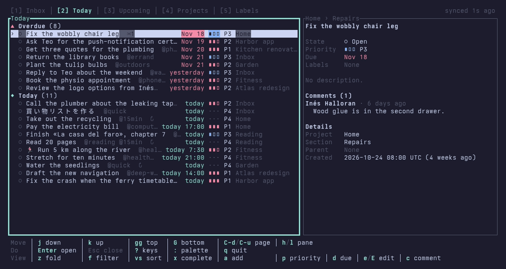

<div align="center"><pre>
░█▀▄░█▀█░▀█▀░█▀█░▀█▀░█▀█░▀█▀░█▀▀░▀█▀
░█▀▄░█▀█░░█░░█▀█░░█░░█░█░░█░░▀▀█░░█░
░▀░▀░▀░▀░░▀░░▀░▀░░▀░░▀▀▀░▀▀▀░▀▀▀░░▀░
</pre></div>

A keyboard-first terminal client for [Todoist](https://todoist.com). It runs on Linux and macOS.

[](https://crates.io/crates/ratatoist)



## Install

Pick one. Each puts `ratatoist` on your `PATH`.

```bash
# From source, with Rust 1.88 or newer
cargo install --locked ratatoist

# A prebuilt binary, through cargo-binstall
cargo binstall ratatoist

# Homebrew
brew install cxrlos/tap/ratatoist

# The shell installer from the latest GitHub release
curl --proto '=https' --tlsv1.2 -LsSf \
  https://github.com/cxrlos/ratatoist/releases/latest/download/ratatoist-installer.sh \
  | sh
```

Prebuilt binaries cover `x86_64` and `aarch64` on Linux and macOS. Every [GitHub release](https://github.com/cxrlos/ratatoist/releases) carries the archives and their checksums.

## Quick start

Try it first on a made-up account. This needs no Todoist account and makes no network requests:

```bash
ratatoist --demo
```

Then log in once with your [Todoist API token](https://app.todoist.com/app/settings/integrations/developer). ratatoist checks it with Todoist and keeps it in your OS keyring:

```bash
ratatoist auth login
ratatoist
```

Press `?` anywhere to see the keys for the screen you are on.

## Docs

- [Configuration](https://github.com/cxrlos/ratatoist/blob/main/docs/config.md): `config.toml`, keys and themes.
- [Keymap](https://github.com/cxrlos/ratatoist/blob/main/docs/keymap.md): every action with its default keys, generated from the code.
- [Logging in](https://github.com/cxrlos/ratatoist/blob/main/docs/auth.md): the API token and the OS keyring.

## Contributing and security

Contributions are welcome; [CONTRIBUTING.md](https://github.com/cxrlos/ratatoist/blob/main/CONTRIBUTING.md) explains the workflow. Please report vulnerabilities privately as described in [SECURITY.md](https://github.com/cxrlos/ratatoist/blob/main/SECURITY.md), not in a public issue.

## License

Licensed under either of [Apache License, Version 2.0](https://github.com/cxrlos/ratatoist/blob/main/LICENSE-APACHE) or [MIT license](https://github.com/cxrlos/ratatoist/blob/main/LICENSE-MIT), at your option.

ratatoist is not created by, affiliated with or supported by Doist.
